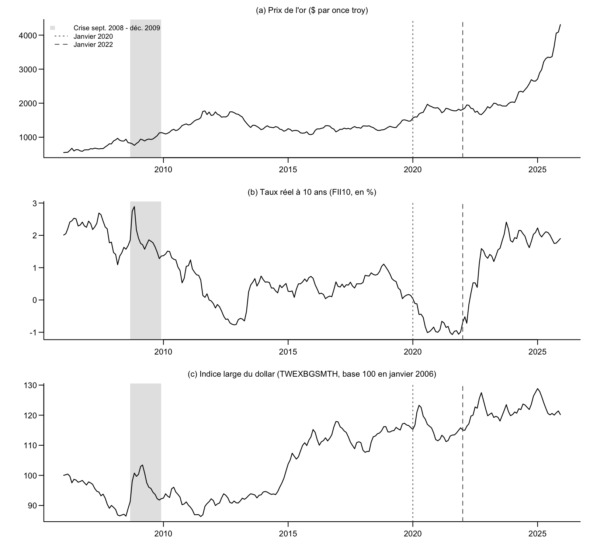
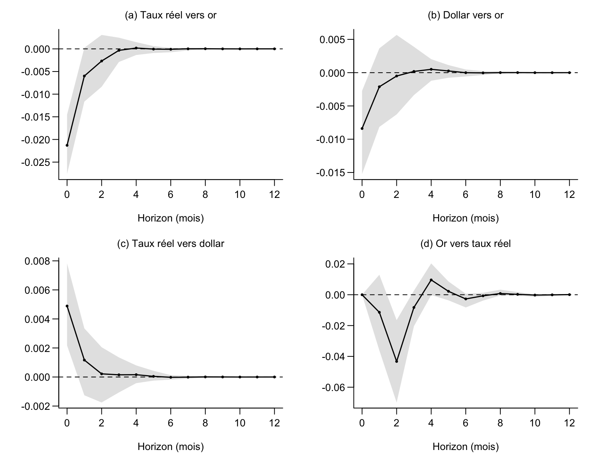
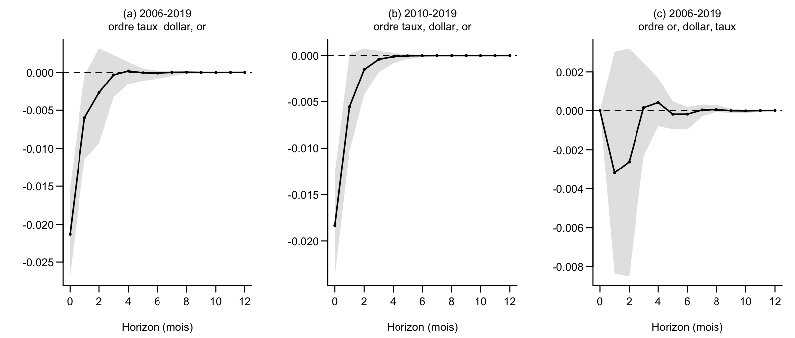

# Do Higher US Real Interest Rates Drive Down Gold Prices? A Time-Series Econometric Study

> [!NOTE]
> **Language Notice / Note sur la langue :** The full econometric report ([`Rapport_projet_series_temporelles.pdf`](./Rapport_projet_series_temporelles.pdf)) and all inline comments inside the R scripts ([`code_et_donnees/projet_or_taux_reels.R`](./code_et_donnees/projet_or_taux_reels.R)) are **written in French**. This project was completed for the M1 *Magistère BFA* Time-Series Econometrics course at **Université Paris-Dauphine – PSL** (instructors: Chloé Derouen & Alice Carroy; authors: Elie Benainous, Maxime Chassang, Sebastian Ramos, Roman Balocchi).

---

## 1. Overview & Research Question

Because gold yields neither coupons nor dividends, its holding cost primarily reflects the real opportunity cost foregone by holding a non-yielding asset rather than an inflation-protected sovereign bond. Economic theory predicts that an increase in US real interest rates raises this opportunity cost and depresses gold prices, while an appreciation of the US dollar—gold's pricing currency—further weighs on gold returns.

This study empirically tests this mechanism using monthly market data from **January 2006 to December 2019 ($T = 168$ observations)** and examines four dimensions:
1. Whether higher US 10-year real rates lower gold prices after controlling for the US dollar;
2. How rapidly gold adjusts to real-rate shocks;
3. The direction of Granger and instantaneous causality between real rates and gold;
4. Whether a stable long-run cointegrating equilibrium exists, and how the **2008–2009 global financial crisis** affects both short-run and long-run relationships.

### Sample Selection (Why 2006–2019 Instead of 2006–2025)

Although data were collected through December 2025 ($T = 240$), the full-sample relationship breaks down sharply starting in **2022**, when aggressive Federal Reserve tightening pushed 10-year TIPS yields from roughly $-1\%$ to $+2\%$ while gold surged past $\$4{,}000/\text{oz}$ instead of declining. Over 2006–2025, static OLS yields $R^2 = 0.09$ and Engle-Granger residual ADF testing rejects cointegration ($\tau = +1.45$ vs. $-3.37$ critical value). Following standard sample-selection practice to exclude both the 2022 regime shift and 2020–2021 Covid-era distortions, the core analysis spans **2006–2019 ($T = 168$)**, with a dedicated structural-break and subsample analysis for **2008–2009** and **2010–2019 ($T = 120$)**.

---

## 2. Data & Transformations

All three series are monthly (no seasonal adjustment required for financial market prices and yields), downloaded on November 4, 2026:

| Variable | Symbol | Source & Series ID | Definition | Transformation |
| :--- | :---: | :--- | :--- | :---: |
| **Gold Price** | $o_t$ | World Bank *Pink Sheet* (`CMO-Historical-Data-Monthly.xlsx`, `Monthly Prices` sheet, `Gold` column) | Monthly average nominal price in USD per troy ounce | $\ln(\text{Gold}_t)$ |
| **US 10Y Real Rate** | $r_t$ | FRED (`FII10`) | 10-Year Treasury Inflation-Indexed Security (TIPS) yield, %, monthly average | Level ($\%$, takes negative values) |
| **Broad US Dollar Index** | $d_t$ | FRED (`TWEXBGSMTH`) | Trade-weighted broad US dollar index (Jan 2006 = 100), monthly average | $\ln(\text{Dollar}_t)$ |

---

## 3. Key Econometric Findings

### 3.1 Univariate Analysis & Real-Rate Forecasting
- **Integration order**: Sequential Augmented Dickey-Fuller (ADF) tests (with Dickey-Fuller critical values for deterministic terms), Phillips-Perron (PP), and KPSS tests all indicate that $o_t$, $r_t$, and $d_t$ are **$\text{I}(1)$ without drift**. *(Sensitivity note: the ADF statistic for $r_t$ fluctuates between $-1.77$ and $-2.12$ across 1–8 lags, though PP and KPSS consistently confirm non-stationarity in levels.)*
- **Univariate ARIMA & out-of-sample forecast**: Estimated on Jan 2006 – Sep 2019 ($T = 165$), an $\text{ARIMA}(0,1,1)$ without drift minimizes both AIC ($-108.45$) and BIC ($-102.25$), with $\hat{\theta} = 0.246$ ($\text{s.e.} = 0.078$, $t = 3.16$). Residuals show no autocorrelation (Ljung-Box $p = 0.68$), though ARCH effects (at lag 12, $p = 0.013$) and non-normality (Jarque-Bera $p < 0.001$) reflect crisis/taper-tantrum outliers. Out-of-sample forecasts for Oct–Dec 2019 ($h = 1, 2, 3$) achieve $\text{RMSE} = 0.016$ vs. $0.045$ for a naive random walk.

### 3.2 Short-Run Multivariate Dynamics ($\text{VAR}(2)$)
- **Specification**: $\text{VAR}(2)$ without deterministic terms on $X_t = (\Delta r_t, \Delta d_t, \Delta o_t)'$ ($T = 165$ effective observations; Portmanteau $p = 0.74$, max characteristic root $0.54 < 1$).
- **Contemporaneous adjustment**: Past lags do not predict monthly gold returns ($F = 0.945$, $p = 0.46$, $R^2 = 0.034$), consistent with a liquid market absorbing news within the month. Strong linkages operate contemporaneously in residual correlations: $\text{corr}(\Delta r_t, \Delta o_t) = -0.53$, $\text{corr}(\Delta d_t, \Delta o_t) = -0.41$, and $\text{corr}(\Delta r_t, \Delta d_t) = +0.39$.
- **Granger vs. instantaneous causality**: $\Delta r_t$ does not Granger-cause $\Delta o_t$ ($p = 0.342$ bivariate), whereas instantaneous causality is highly significant ($p < 0.001$; $\chi^2 = 35.00$). An unexpected reverse Granger causality from gold to real rates appears over 2006–2019 ($p = 0.019$), but disappears once the crisis is excluded.
- **Impulse Response Functions (Cholesky order $\Delta r_t \to \Delta d_t \to \Delta o_t$)**: A $+1$ s.d. real-rate shock ($+0.17$ pp) immediately lowers gold by **$-2.13\%$** ($[-2.76\%, -1.45\%]$) in month $h = 0$, followed by $-0.60\%$ at $h = 1$, vanishing within 3–4 months ($12$-month cumulative effect $\approx -3.0\%$). A real-rate shock also appreciates the dollar ($+0.49\%$), while a $+1$ s.d. dollar shock lowers gold by $-0.84\%$. *(Note: reversing the Cholesky ordering sets the impact response of gold to zero by construction.)*

### 3.3 Long-Run Cointegration & Error-Correction Model
- Over 2006–2019, static OLS estimates $o_t = 7.306 - 0.305\,r_t + z_t$ ($R^2 = 0.82$), and the Engle-Granger residual ADF rejects no-cointegration at $5\%$ ($\tau = -3.77 < -3.37$, though above the $1\%$ threshold $-3.96$; Phillips-Ouliaris $p = 0.071$).
- However, estimating the proposed Error-Correction Model ($\Delta o_t = c + \alpha \hat{z}_{t-1} + \beta_1 \Delta r_t + \beta_2 \Delta d_t + u_t$) shows that while contemporaneous short-run effects are highly significant ($\hat{\beta}_1 = -0.099$, $p < 0.001$; $\hat{\beta}_2 = -0.695$, $p < 0.001$), the **error-correction coefficient on gold is insignificant ($\hat{\alpha} = -0.023$, $p = 0.29$)**—it is instead the real rate that adjusts ($\hat{\alpha} = -0.368$, $t = -4.08$).

### 3.4 Impact of the 2008–2009 Financial Crisis & Post-Crisis Subsample (2010–2019)
- **Structural break**: A Chow test at September 2008 ($F = 6.27, p = 0.0005$) and Andrews $\sup\text{-}F$ test ($24.7, p = 0.0004$, break dated August 2008) detect a localized crisis break, while recursive CUSUM ($p = 0.75$) confirms no permanent parameter drift. Zivot-Andrews unit-root tests with an endogenous break confirm $\text{I}(1)$ integration ($-3.29$ and $-3.25$ vs. $-4.80$ 5% CV).
- **Safe-haven attenuation**: Interacting $\Delta r_t$ with a crisis dummy (Sep 2008 – Dec 2009) shows that gold sensitivity to real rates drops from $-0.116$ ($t = -6.51$) outside the crisis to $-0.035$ during the crisis (interaction $+0.081, p = 0.011$; joint $F = 4.76, p = 0.0098$).
- **Post-crisis subsample (2010–2019, $T = 120$, $\text{VAR}(1)$)**: The **short-run negative effect holds** (contemporaneous slope $-0.118, t = -6.92$; IRF impact $-1.83\%$ $[-2.38\%, -1.27\%]$), whereas both reverse Granger causality ($\Delta o_t \to \Delta r_t$, $p = 0.45$) and Engle-Granger cointegration ($\tau = -1.93 > -3.39$) vanish.

**Conclusion**: Higher US real interest rates robustly depress gold prices **in the short run** (within the month, vanishing in 3–4 months), but **no stable long-run equilibrium** links the two series across regimes.

---

## 4. Visual Previews

| Sample Overview & 2022 Structural Break | VAR(2) Impulse Responses (2006–2019) |
| :---: | :---: |
|  |  |

**Crisis Subsample & Cholesky Ordering Sensitivity:**


---

## 5. Repository Structure & Reproducibility

```text
.
├── README.md                                  # English overview (this file)
├── Rapport_projet_series_temporelles.pdf      # Full 15-page econometric report (in French)
└── code_et_donnees/
    ├── projet_or_taux_reels.R                 # Main R script covering sections 0–11 (French comments)
    ├── figures_rapport.R                      # Reproduces all 10 report figures & key summary tables
    ├── CMO-Historical-Data-Monthly.xlsx       # World Bank Pink Sheet gold prices
    ├── FII10.csv                              # FRED 10Y TIPS real yield
    ├── TWEXBGSMTH.csv                         # FRED broad trade-weighted US dollar index
    ├── resultats_console.txt                  # Full saved R console output
    ├── figures_rapport_sortie.txt             # Saved console output from figures_rapport.R
    ├── figures/                               # Exploratory plots generated by projet_or_taux_reels.R
    └── figures_rapport/                       # Publication-style B&W figures used in the PDF report
```

### Running the R Code

1. Set the working directory to `code_et_donnees/` (e.g., in RStudio: `Session > Set Working Directory > To Source File Location`).
2. Install required CRAN packages if not already present:
   ```r
   install.packages(c("readxl", "xts", "urca", "tseries", "forecast", "FinTS", "vars", "strucchange"))
   ```
3. Run the scripts in order (tested under R 4.5):
   ```r
   source("projet_or_taux_reels.R")
   source("figures_rapport.R")
   ```
   *(A fixed `set.seed(123)` ensures reproducible bootstrap confidence bands for all impulse-response functions.)*
